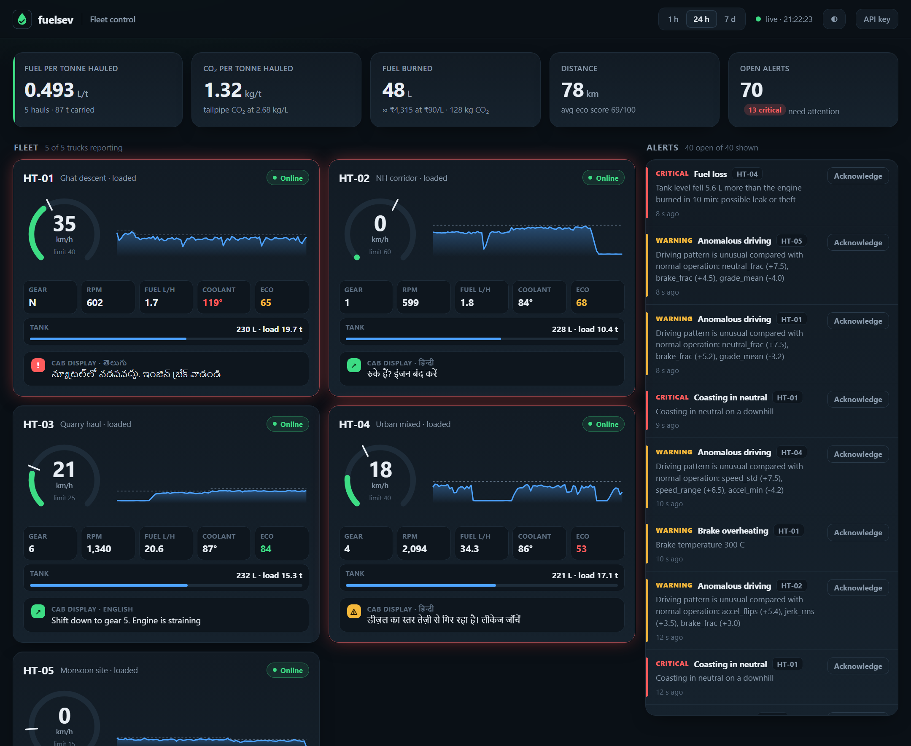
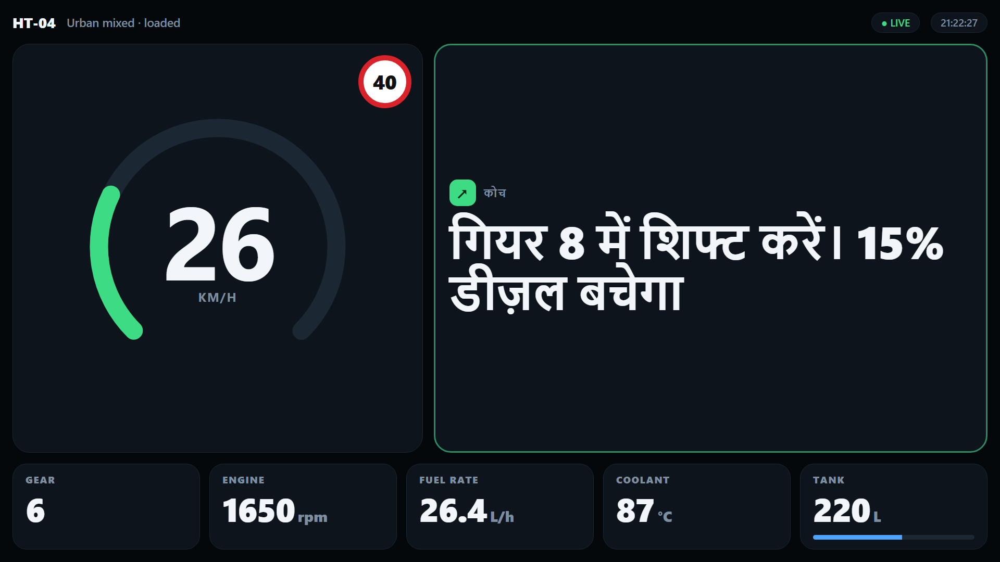
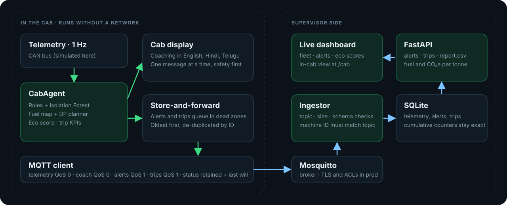
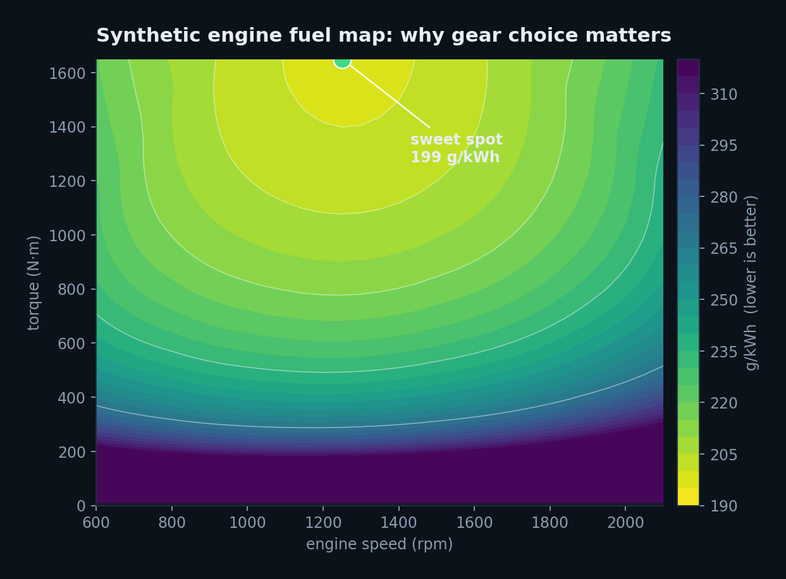
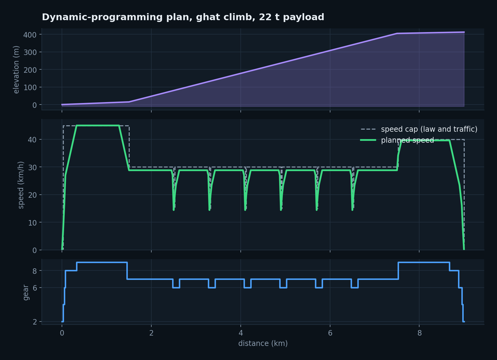
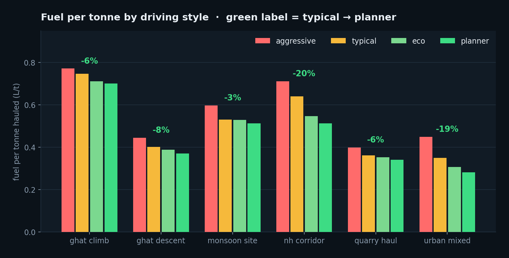
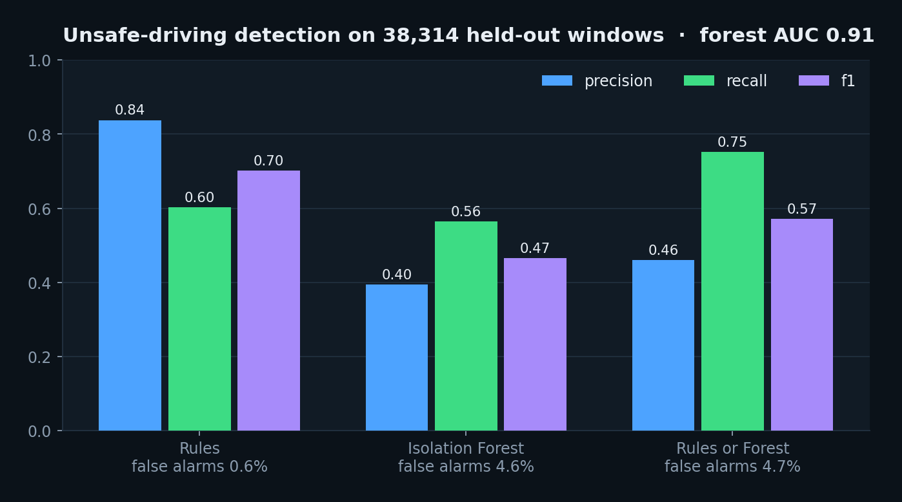

<div align="center">


B.Tech final-year project, JNTU Hyderabad. Author: Abhinav.
<br>

[](pyproject.toml)
[](#supervisor-api)
[](#architecture)
[](#one-command-docker)
[](https://github.com/abhinavannareddy/FuelSev/actions/workflows/ci.yml)
[](LICENSE)

**[Try it in 30 seconds](#try-it-in-30-seconds)** · **[Screenshots](#what-you-get)** · **[Architecture](#architecture)** · **[Results](#results)** · **[API](#supervisor-api)**

</div>

fuelsev runs an agent **in the truck cab** that coaches the operator towards fuel-efficient driving in English, Hindi or Telugu, and alerts a supervisor about unsafe driving and machine faults, **even when the truck is in a mobile dead zone**. The supervisor gets a live fleet dashboard and an API that reports **fuel and CO2e per tonne hauled**.

It is built around sustainable construction and mining logistics and around the conditions Indian haul fleets actually face: ghat roads, speed breakers, toll plazas, monsoon mud, overloading, diesel pilferage. All vehicle data is synthetic (see [Limitations](#limitations)).

<table>
<tr>
<td align="center" width="25%"><h2>up to 20%</h2>less fuel per tonne on highway and town hauls (planned vs typical driver, simulated)</td>
<td align="center" width="25%"><h2>0 alerts lost</h2>in dead zones: queued on the truck, sent oldest first, stored once</td>
<td align="center" width="25%"><h2>3 languages</h2>English, Hindi and Telugu cab messages</td>
<td align="center" width="25%"><h2>6 road types</h2>ghat climb and descent, NH, quarry, urban, monsoon site</td>
</tr>
</table>

## Try it in 30 seconds

No broker, no Docker, no hardware. One command starts the supervisor API and a simulated fleet of five trucks (one in a ghat dead zone with an engine-overheat fault, one with a diesel leak):

```bash
git clone https://github.com/abhinavannareddy/FuelSev.git && cd FuelSev
pip install -e .
fuelsev train            # optional, a few minutes: adds the Isolation Forest detector
fuelsev demo --open      # dashboard at http://127.0.0.1:8000
```

| URL | What it is |
|---|---|
| `/` | live supervisor dashboard |
| `/cab?machine=HT-01` | the operator's in-cab display for one truck |
| `/docs` | interactive API documentation |

## What you get

### Supervisor dashboard

Live fleet view: fuel and CO2e per tonne, rupee cost, per-truck speed against the limit, gear, revs, coolant, tank, eco score, and what each cab display is telling its driver right now, in the driver's own language. Alerts arrive with severity and can be acknowledged. Light and dark themes, works on a phone, no external assets (it runs on a closed network).

<p align="center"></p>

### In-cab display

Built for a glance from the driver's seat: one big speed dial with the limit sign, one message at a time (safety before faults before efficiency), large type, no menus. Messages are shown in English, Hindi or Telugu.

<p align="center"></p>

### Features

- **Fuel coaching** from a fuel map: tells the driver which gear to be in and when to ease off, only when the saving is worth the nag.
- **Optimal speed and gear plans** from a dynamic-programming planner that respects torque, rpm, traction, speed breakers, hairpins and stops.
- **Unsafe-driving detection**: explicit rules (overspeed, harsh braking, neutral coasting, over-revving, overload) plus an unsupervised Isolation Forest for patterns no single threshold describes.
- **Fault and theft alerts**: brake and coolant temperature, oil pressure, fuel loss and abnormal fuel flow.
- **Store-and-forward uplink** so ghat and quarry dead zones never lose an alert or a trip.
- **Fuel and CO2e per tonne** reports (JSON and CSV), computed from cumulative counters so dropped packets do not distort totals.
- **Hardened ingest**: schema validation on every message, machine ID must match its topic, optional API key, CSV formula injection neutralised, non-root container.

## Contents

- [Try it in 30 seconds](#try-it-in-30-seconds)
- [What you get](#what-you-get)
- [Architecture](#architecture)
- [Designed for Indian roads](#designed-for-indian-roads)
- [How it works](#how-it-works)
- [Quick start](#quick-start)
- [Supervisor API](#supervisor-api)
- [Results](#results)
- [Emission factor](#emission-factor)
- [Limitations](#limitations)
- [Project layout](#project-layout)

## Architecture

<p align="center"></p>

MQTT topics (`v1` is the schema version):

| Topic | QoS | Purpose |
|---|---|---|
| `fuelsev/v1/<machine>/telemetry` | 0 | 1 Hz live view; dropped while offline |
| `fuelsev/v1/<machine>/coach` | 0 | cab-display messages |
| `fuelsev/v1/<machine>/alerts` | 1 | supervisor alerts; buffered on the machine while offline |
| `fuelsev/v1/<machine>/trips` | 1 | one summary per haul cycle; buffered while offline |
| `fuelsev/v1/<machine>/status` | 1, retained | online/offline; offline is the broker-published last will |

## Designed for Indian roads

The route scenarios, detectors and delivery layer are built around conditions that Indian haul fleets actually face. The road data is an illustrative composite, not a survey (see [Limitations](#limitations)); every assumption sits in `src/fuelsev/routes.py` and is easy to edit.

| Condition | How the project handles it |
|---|---|
| **Speed breakers** and humps, often unmarked | Route events with a crossing-speed cap; the planner slows for them, the coach says "speed breaker ahead" when the truck is too fast |
| **Ghat roads**, hairpins, long steep descents | `ghat_climb` / `ghat_descent` scenarios; hairpin speed caps; descent-gear advice (use engine braking in a low gear rather than riding the brakes) |
| **Coasting in neutral** downhill, a common and dangerous habit | Dedicated `NEUTRAL_COASTING` rule (critical on steep grades) and a cab message |
| **Brake fade** on long descents | Brake temperature model, `BRAKE_OVERHEAT` alert |
| **Toll plazas, weighbridges, railway level crossings, signals** | Scheduled stops with dwell times. Idle is counted only after the first 60 s of each stop, so unavoidable waits are not held against the driver. The coach suggests switching off after a minute |
| **Mixed traffic** (tractors, carts, two-wheelers, cattle) | Each segment has a `legal_kmh` and a lower `traffic_kmh`; the effective cap is the smaller |
| **Patched, potholed and unpaved roads** | Per-surface rolling resistance and friction; the planner and coach use it |
| **Monsoon mud** | Low-friction surface; wheel force is limited by traction, so the planner will not ask for torque the tyres cannot deliver |
| **Overloading**, widespread in tipper fleets | `OVERLOAD` rule from payload against the rated payload |
| **Diesel pilferage and leaks** | `FUEL_LOSS` rule: tank level falls faster than the engine's burn can explain |
| **Heat** (35 °C plains) | Air density and cooling model at 34 °C ambient; `COOLANT_HIGH` alert |
| **Mobile dead zones** in ghats, cuttings and quarries | Alerts and trip summaries queue on the machine (bounded FIFO) and are sent, oldest first, when the link returns. Alert IDs are deterministic, so a redelivered message is stored once |
| **Language** | Cab messages in English, Hindi and Telugu |
| **Cost** | Fuel cost in rupees (assumed ₹90/L, `constants.py`) |

## How it works

**Fuel map (SciPy).** A grid of fuel rate against engine speed and torque is interpolated with `scipy.interpolate.RegularGridInterpolator`. The map is *synthetic*: a Willans-line diesel model with a plausible best efficiency of about 200 g/kWh, written to `src/fuelsev/data/fuel_map.csv`. Swap in a real engine map by providing a CSV with the same columns.

<p align="center"> </p>

**Planner (NumPy dynamic programming).** Each leg is discretised into 25 m nodes and speeds into 0.5 m/s levels. The DP state is (node, speed, gear). A transition assumes constant acceleration over the step, computes wheel force, converts to engine torque and rpm for the gear, and looks up fuel in the map. It is vectorised over all speed pairs and gears at once. The objective is fuel plus a time penalty (`lam_l_per_s`) plus gear-shift and service-brake penalties; transitions that exceed the full-load torque curve, the rpm window or the traction limit are infeasible. The output is a target speed and gear for every point on the route.

**Coach.** Every second the coach considers: rule detections (safety and faults), look-ahead warnings, "shift to gear N" computed by asking the fuel map what each gear would burn right now, "ease off to X km/h" when the truck is well above the plan's speed and the saving is at least 8 %, descent-gear advice and idle shutdown. One message is shown at a time (safety first), with per-message cooldowns so the operator is not nagged.

**Detection: rules baseline plus Isolation Forest (scikit-learn).** The rules (`rules.py`) are explicit thresholds: overspeed, harsh braking, neutral coasting, over-revving, brake and coolant temperature, oil pressure, fuel loss, fuel-flow anomalies, overload and excess idle. The Isolation Forest (`anomaly.py`) is trained without labels on 10-second windows (18 features: speed and its variability, braking, revs, throttle smoothness, speed relative to the limit and so on) from a baseline fleet of eco, planner and typical drivers. The alert threshold is set at a 2 % false-alarm rate on training data. Two anomalous windows in a row raise `ANOMALOUS_DRIVING`, with the three most unusual features in the message.

**Metrics.** Fuel per tonne = trip fuel ÷ payload carried (L/t). CO2e per tonne = fuel per tonne × the emission factor. Fleet figures are *sums* (total fuel ÷ total payload), never an average of ratios. Reports use cumulative counters carried in the telemetry, so totals stay correct even if QoS 0 packets are dropped or telemetry is stored at a lower rate.

**Eco score (0–100).** 100 minus penalties for fuel burned above the best-gear choice (up to 35 points, saturating at 15 %), harsh braking per 10 minutes (25, saturating at 6), time more than 10 % over the limit (20, at 15 %) and excess idling (20, at 10 %).

## Quick start

### Fastest: the built-in demo

```bash
pip install -e .
fuelsev demo --open
```

See [Try it in 30 seconds](#try-it-in-30-seconds).

### One command (Docker)

```bash
docker compose up --build
```

This starts the Mosquitto broker, the API, and two simulated machines: `HT-01` (an aggressive driver on a ghat descent, Telugu messages, a simulated dead zone and an engine-overheat fault) and `HT-02` (a typical driver on an NH corridor, Hindi messages). The image trains the anomaly model at build time. Then:

```bash
curl localhost:8000/health
curl localhost:8000/machines
curl "localhost:8000/alerts?severity=critical"
curl "localhost:8000/report?hours=1"
curl -o report.csv "localhost:8000/report.csv?hours=1"
```

The dashboard is at http://localhost:8000/ and the interactive API docs at http://localhost:8000/docs. Ports are bound to `127.0.0.1` only.

### Without Docker

```bash
python -m venv .venv && source .venv/bin/activate
pip install -e ".[dev]"

fuelsev plan --route ghat_climb --payload-t 22            # run the DP planner
fuelsev simulate --route urban_mixed --driver aggressive  # simulate and print trip KPIs
fuelsev train                                             # writes models/anomaly.joblib (a few minutes)
fuelsev evaluate                                          # benchmark; writes results/

# with a Mosquitto broker on localhost:1883
fuelsev api &                                             # also serves the dashboard at /
fuelsev machine --id HT-01 --route ghat_descent --driver aggressive --model models/anomaly.joblib
```

Run the tests with `pytest`. `python scripts/mqtt_e2e.py` (needs `pip install amqtt`) runs the full MQTT path against a throw-away in-process broker, including a simulated dead zone.

### Configuration

| Variable | Meaning |
|---|---|
| `FUELSEV_MQTT_HOST`, `_PORT`, `_USER`, `_PASSWORD`, `_TLS` | broker connection (`_TLS=1` enables TLS) |
| `FUELSEV_DB_PATH` | SQLite file for the API (default `fuelsev.db`) |
| `FUELSEV_API_KEY` | if set, every endpoint except `/health` requires header `X-API-Key` |

The bundled `mosquitto.conf` allows anonymous clients. That is for development on a private Compose network only. For a real deployment use a password file, TLS and per-machine ACLs.

## Supervisor API

| Endpoint | Description |
|---|---|
| `GET /`, `GET /cab` | live dashboard and in-cab display (the pages are open; the data they read needs the API key if one is set) |
| `GET /health` | liveness, MQTT state, ingest counters |
| `GET /machines` | machines with online state and open alert counts |
| `GET /telemetry/{id}/latest`, `/recent` | most recent stored sample, or the last N for charts |
| `GET /coach/{id}` | latest cab-display messages (in memory, not stored) |
| `GET /alerts` | filter by `machine_id`, `severity`, `code`, `acknowledged`, `since`; paged |
| `POST /alerts/{id}/ack` | acknowledge an alert |
| `GET /trips` | trip summaries |
| `GET /report`, `GET /report.csv` | fuel, CO2e per tonne, distance, idle share, eco score and alert counts per machine and fleet over a window |

The ingestor accepts a message only if the topic is well formed, the payload is under 64 KB, it validates against the schema, and the machine ID in the payload equals the one in the topic. CSV output neutralises spreadsheet formulas.

## Results

All numbers come from the simulator and the same agent that runs in the cab. They show how the system behaves, not what a real truck would burn. Reproduce with `fuelsev evaluate` (3 seeds per cell; exact values depend on the seeds).

### Fuel per tonne hauled (L/t, one haul cycle including the empty return)

<p align="center"></p>

| Route | planner | eco | typical | aggressive | typical → planner |
|---|---|---|---|---|---|
| ghat_climb | 0.701 | 0.711 | 0.747 | 0.771 | 6% less fuel |
| ghat_descent | 0.370 | 0.388 | 0.402 | 0.445 | 8% less fuel |
| monsoon_site | 0.513 | 0.528 | 0.530 | 0.597 | 3% less fuel |
| nh_corridor | 0.513 | 0.547 | 0.640 | 0.711 | 20% less fuel |
| quarry_haul | 0.340 | 0.352 | 0.362 | 0.399 | 6% less fuel |
| urban_mixed | 0.282 | 0.306 | 0.350 | 0.449 | 19% less fuel |

Multiply by 2.68 for kg CO2 per tonne (for example 0.640 L/t on the NH corridor is 1.72 kg CO2/t; the planner's 0.513 L/t is 1.37 kg CO2/t). The savings are largest on open highway and in town, where driver behaviour decides fuel use, and smallest on the steep or muddy roads where the terrain forces the speed. The "planner" driver tracks the DP plan exactly and is the upper bound on what coaching could achieve; real operators will capture only part of the gap.

### Unsafe-driving detection

<p align="center"></p>

Held-out seeds, 38,314 ten-second windows across the six routes and four driving styles; 1,931 windows (5 %) are labelled unsafe by the simulator's hidden ground truth. "Rules" counts safety rules only.

| Detector | Precision | Recall | F1 | False-alarm rate |
|---|---|---|---|---|
| Rules (baseline) | 0.84 | 0.60 | 0.70 | 0.6 % |
| Isolation Forest | 0.40 | 0.57 | 0.47 | 4.6 % |
| Rules or Forest | 0.46 | 0.75 | 0.57 | 4.7 % |

The Isolation Forest's ranking quality is good (ROC AUC 0.91) but, as a single-window detector, it is much less precise than the rules. The rules catch well-defined events cleanly. The forest adds about 15 points of recall by catching patterns that no single threshold describes, at the cost of more false alarms. In the agent this is mitigated by requiring two consecutive anomalous windows and by a per-alert cooldown, and the forest's alerts are marked as warnings, never critical. Eco and planner drivers are almost never flagged (under 1 % of windows); aggressive drivers are flagged in 26 % of windows.

## Emission factor

CO2 emissions are `fuel litres × 2.68 kg CO2/L`.

- **IPCC 2006 Guidelines**, default for gas/diesel oil: 74.1 t CO2/TJ on a net calorific value of 43.0 TJ/Gg, reproduced in Annex VI of [EU Implementing Regulation 2018/2066](https://legislation.gov.uk/eur/2018/2066/annex/VI/2020-12-31/data.xht). With a density of about 0.84 kg/L: 74.1 × 43.0 × 0.84 / 1000 = 2.68 kg/L.
- A carbon-balance estimate (86 % carbon by mass, 0.85 kg/L, 44/12) gives the same 2.68, as used in a [TRAI presentation by Rangan Banerjee (2017)](https://trai.gov.in/sites/default/files/2024-11/Rangan%20Banerjee_05_04_2017.pdf).

The factor is **tailpipe CO2 only**: methane and nitrous oxide and upstream (well-to-tank) emissions are excluded, so "CO2e" in the reports is a CO2 figure. The value is a single constant (`CO2_KG_PER_L_DIESEL` in `constants.py`) and the metric functions accept an override.

## Limitations

- **The engine fuel map and vehicle are synthetic**, . Absolute litres are indicative; the *relative* differences between driving styles are the meaningful output.
- **Routes are composites, not surveyed roads.** Grades, surface quality, hazard positions and speed caps are assumptions. Speed limits in particular must be checked for your state and vehicle class before any real use.
- **Results are simulated.** The driver models, including the "unsafe episodes" used as detection ground truth, are my own constructions. The detector scores reflect how well it finds those simulated behaviours, and will differ on real drivers.
- **The Isolation Forest is trained on simulated baseline driving.** On a real fleet it should be retrained on that fleet's normal driving.
- **The planner ignores speed lost during a gear change** and assumes the truck is map-matched to its route (position along a known route comes from GPS in practice; here the simulator supplies it).
- **Hindi and Telugu messages have not been reviewed by native-speaking operators**, nor tested on a real display font.
- **MQTT in the compose file is unauthenticated** (development only), and the API key is a single shared secret.
- Telemetry timestamps are re-stamped by the machine process with the wall clock; a real deployment needs synchronised time (GPS or NTP).
- A trip interrupted by shutdown is not reported, so it cannot distort fuel-per-tonne figures.

## Project layout

```
src/fuelsev/
  engine.py, fuelmap.py, vehicle.py   engine model, SciPy fuel map, truck physics
  routes.py, drivers.py               Indian road scenarios, driver and fault models
  planner.py                          NumPy dynamic-programming speed and gear planner
  simulator.py                        time-domain simulator with hidden ground truth
  rules.py, features.py, anomaly.py   rules baseline, window features, Isolation Forest
  coach.py, agent.py, i18n.py         cab coaching, the in-cab agent, en/hi/te messages
  mqtt.py, machine.py                 MQTT link, store-and-forward, machine process
  store.py, api.py                    SQLite store, ingestor and FastAPI app
  demo.py, web/                       one-command demo fleet, dashboard and cab display pages
  metrics.py, constants.py            fuel/CO2e metrics, documented constants
  training.py, evaluate.py, cli.py    training, benchmarks, command line
tests/                                pytest suite
scripts/mqtt_e2e.py                   end-to-end MQTT check without Docker
scripts/make_figures.py               regenerates docs/img charts from the code and results/
docs/img/                             README images
```

## Licence

MIT. Copyright (c) 2026 Abhinav.
